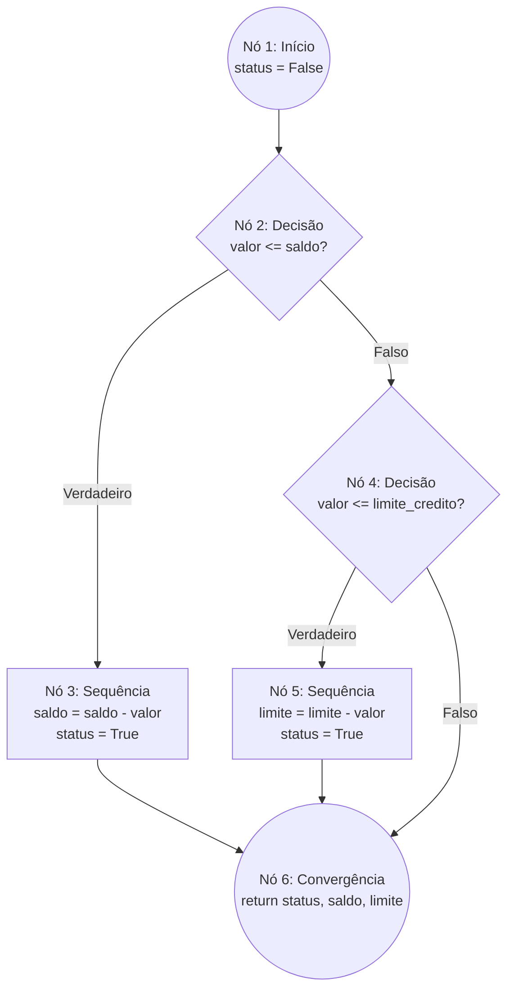

# Teste de Caixa Branca e Grafo de Fluxo (CFG)

Projeto desenvolvido para praticar técnicas de **Teste de Caixa Branca** em Python, aplicando análise de caminhos independentes e cálculo de complexidade ciclomática em uma operação de saque bancário.

## Grafo de Fluxo de Controle (CFG)

## Complexidade Ciclomática
* **Nós (N):** 6
* **Arestas (E):** 7
* **Cálculo:** \(V(G) = E - N + 2 = 7 - 6 + 2 = \mathbf{3}\) caminhos independentes.

## Casos de Teste Executados

| Caso de Teste | Caminho Lógico | Entrada `(valor, saldo, limite)` | Saída `(status, saldo, limite)` |
| :--- | :--- | :--- | :--- |
| **CT 01** | `1 → 2 → 3 → 6` | `(200, 500, 1000)` | `(True, 300, 1000)` |
| **CT 02** | `1 → 2 → 4 → 5 → 6` | `(700, 500, 1000)` | `(True, 500, 300)` |
| **CT 03** | `1 → 2 → 4 → 6` | `(1500, 500, 1000)` | `(False, 500, 1000)` |
