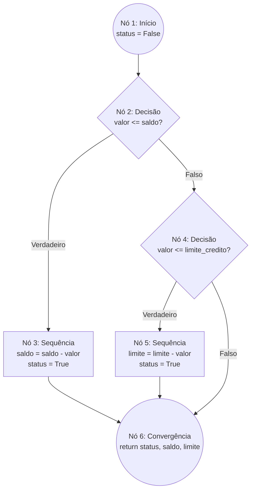
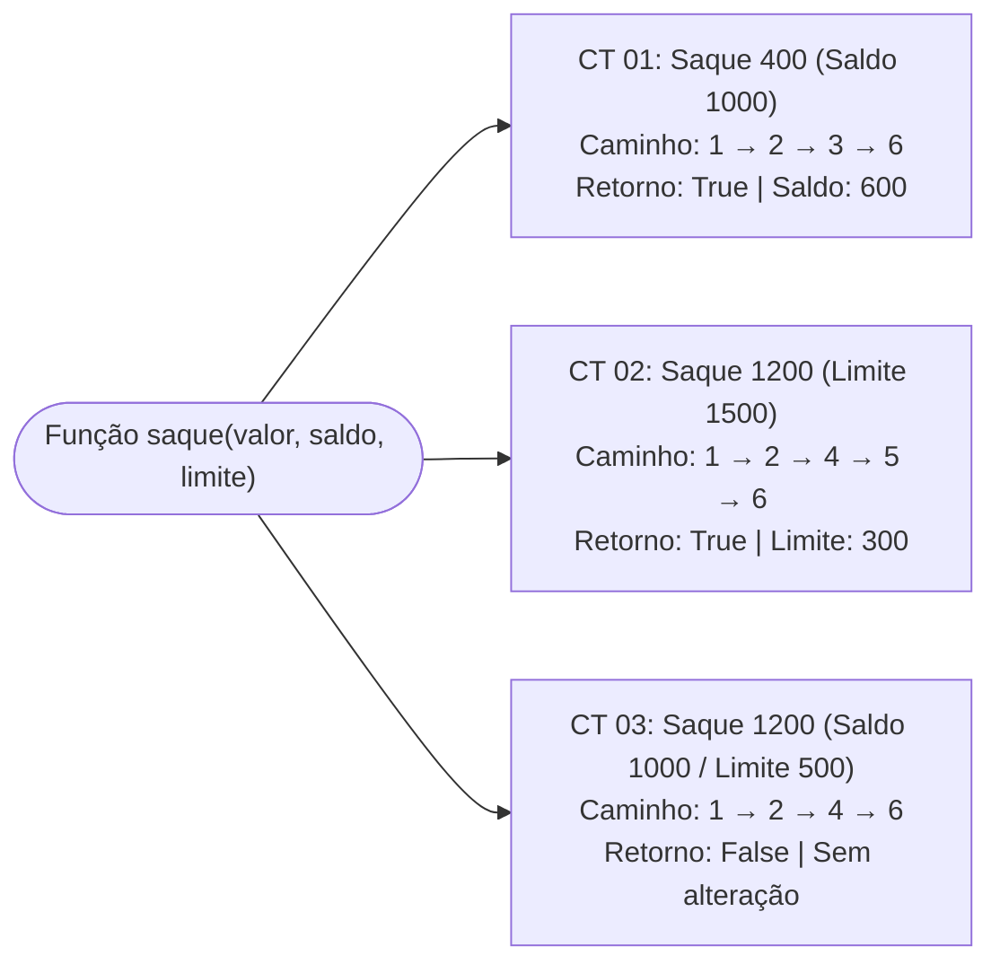

# Teste de Caixa Branca e Grafo de Fluxo (CFG)

Projeto desenvolvido para praticar técnicas de **Teste de Caixa Branca** em Python, aplicando análise de caminhos independentes e cálculo de complexidade ciclomática em uma operação de saque bancário.

## 1. Grafo de Fluxo de Controle (CFG) — Atividade 01

### Complexidade Ciclomática
* **Nós (N):** 6
* **Arestas (E):** 7
* **Cálculo:** V(G) = E - N + 2 = 7 - 6 + 2 = **3 caminhos independentes**

---

## 2. Fluxo de Validação dos Casos de Teste — Atividade 02

### Tabela de Resultados Executados (`atividade2_teste.py`)

| Caso de Teste | Caminho Lógico | Entrada `(valor, saldo, limite)` | Saída Esperada `(status, saldo, limite)` |
| :--- | :--- | :--- | :--- |
| **CT 01** | `1 → 2 → 3 → 6` | `(400, 1000, 500)` | `(True, 600, 500)` |
| **CT 02** | `1 → 2 → 4 → 5 → 6` | `(1200, 1000, 1500)` | `(True, 1000, 300)` |
| **CT 03** | `1 → 2 → 4 → 6` | `(1200, 1000, 500)` | `(False, 1000, 500)` |
